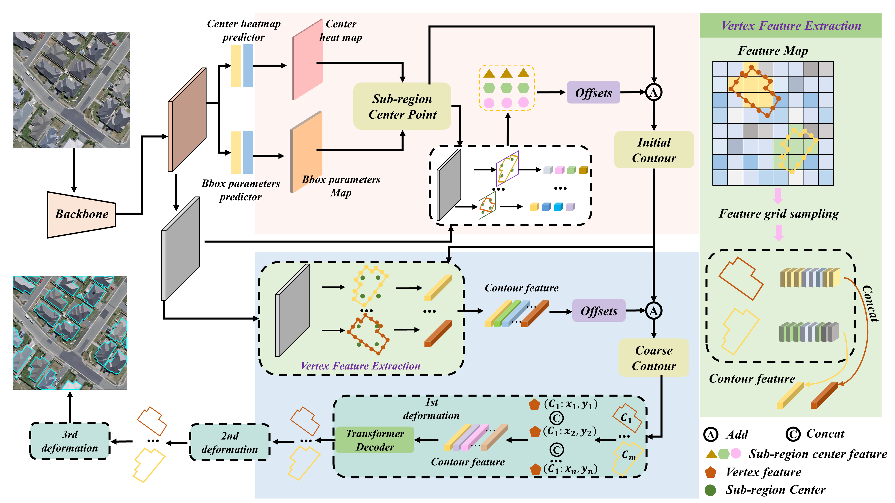

# Yaoteng Zhang

Ph.D. Candidate in Computer Science · Northwestern Polytechnical University

<table>
<tr>
<td width="76%" valign="top">

I am pursuing a Ph.D. degree with the School of Computer Science, Northwestern Polytechnical University, Xi'an, China. I received my B.Eng. and M.Eng. degrees in Surveying and Mapping from China University of Petroleum.

My research focuses on **continual and incremental learning**, **object detection and semantic segmentation**, and **remote sensing and vision-language models**. I am interested in building visual systems that can learn new concepts while retaining what they have already learned.

✉ [Email](mailto:zhang_yt@mail.nwpu.edu.cn)　/　🎓 [Google Scholar](https://scholar.google.com/citations?user=oX0Sv1YAAAAJ&hl=en&oi=sra)　/　◉ [GitHub](https://github.com/zyt95579)

</td>
<td width="24%" align="right" valign="top">

</td>
</tr>
</table>

## News

- **May 2026** · STAR-IOD was accepted by *ISPRS Journal of Photogrammetry and Remote Sensing*. [Paper](https://arxiv.org/pdf/2605.20738) · [Code](https://github.com/zyt95579/STAR-IOD)
- **Mar. 2026** · PDP-IOD was accepted to **CVPR 2026**. [Paper](https://arxiv.org/abs/2603.02286) · [Code](https://github.com/zyt95579/PDP_IOD)
- **2025** · PolyBuild was published in *IEEE Journal of Selected Topics in Applied Earth Observations and Remote Sensing*.

## Publications

Selected papers. **My name is underlined.** For the complete and current list, please see [Google Scholar](https://scholar.google.com/citations?user=oX0Sv1YAAAAJ&hl=en&oi=sra).

<table>
<tr>
<td width="27%" valign="middle">

</td>
<td valign="middle">

**STAR-IOD: Scale-decoupled Topology Alignment with Pseudo-label Refinement for Remote Sensing Incremental Object Detection** 
<u>Yaoteng Zhang</u>, Qing Zhou, Junyu Gao, Qi Wang 
*ISPRS Journal of Photogrammetry and Remote Sensing*, 2026 
[Paper](https://arxiv.org/pdf/2605.20738) / [Code](https://github.com/zyt95579/STAR-IOD) / [Dataset](https://github.com/zyt95579/STAR-IOD)

Scale-decoupled topology distillation and clustering-driven pseudo labels help retain old categories during remote-sensing incremental detection.

</td>
</tr>
<tr>
<td width="27%" valign="middle">

</td>
<td valign="middle">

**Beyond Prompt Degradation: Prototype-guided Dual-pool Prompting for Incremental Object Detection** 
<u>Yaoteng Zhang</u>, Zhou Qing, Junyu Gao, Qi Wang 
*IEEE/CVF Conference on Computer Vision and Pattern Recognition (CVPR)*, 2026 
[Paper](https://arxiv.org/abs/2603.02286) / [Code](https://github.com/zyt95579/PDP_IOD)

A dual-pool prompt framework separates shared and task-specific knowledge, with prototype-guided pseudo-label generation for incremental learning.

</td>
</tr>
<tr>
<td width="27%" valign="middle" align="center">

</td>
<td valign="middle">

**PolyBuild: An End-to-End Method for Polygonal Building Contour Extraction From High-Resolution Remote Sensing Images** 
<u>Yaoteng Zhang</u>, Julin Zhang, Guangshuai Wang, Jiwei Deng, Hui Sheng, Yasir Muhammad, Shiqing Wei 
*IEEE Journal of Selected Topics in Applied Earth Observations and Remote Sensing*, 2025 
[Paper](https://ieeexplore.ieee.org/stamp/stamp.jsp?arnumber=10988661)

An end-to-end method for extracting polygonal building contours from high-resolution remote-sensing images.

</td>
</tr>
</table>

## Research Interests

Continual / Incremental Learning · Object Detection · Semantic Segmentation · Remote Sensing · Vision-Language Models

---

📍 Xi'an, China　·　[Google Scholar](https://scholar.google.com/citations?user=oX0Sv1YAAAAJ&hl=en&oi=sra)　·　[Email](mailto:zhang_yt@mail.nwpu.edu.cn)

